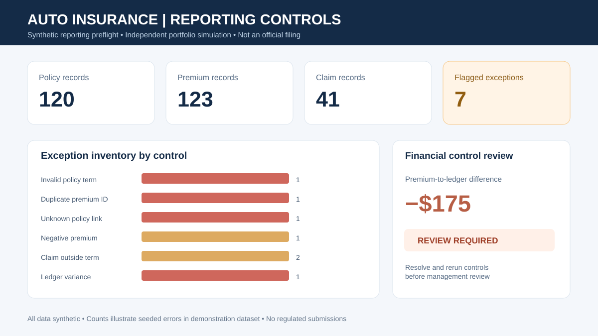
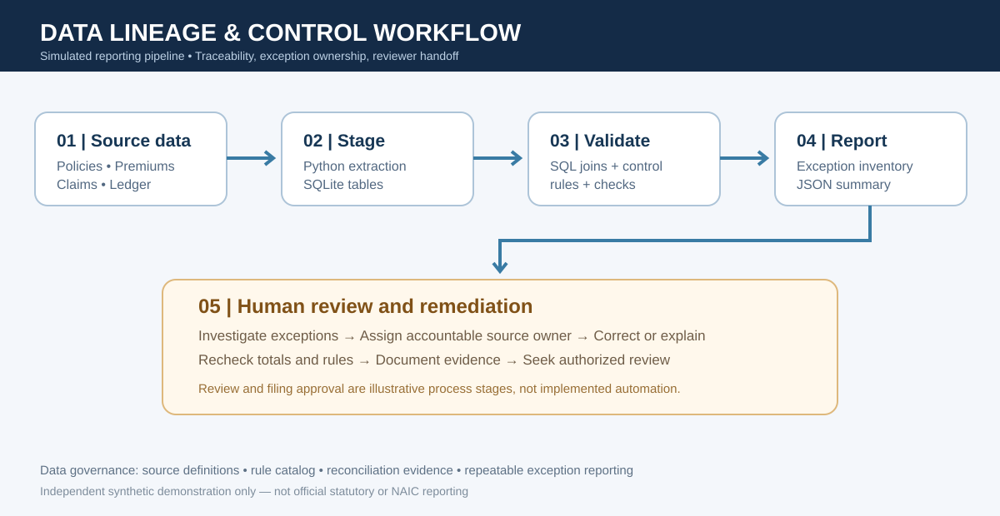

# Auto Insurance Reporting Controls

**Independent synthetic portfolio project — Jalaan Fields** | Python · SQL · SQLite · Reporting controls · Data quality

Demonstrates a reproducible, audit-oriented data validation and reconciliation workflow across simulated **auto policy, premium, claim, and financial-control** data. Built to practice the concepts behind controlled regulatory-support reporting: data lineage, exception inventories, documented rules, review gates, and accurate cross-source financial reconciliation.

> **Educational simulation only.** This is NOT an official NAIC MCAS filing, statutory report, regulator-approved schema, production insurer workflow, or regulatory submission. All data are synthetic.

## Visual overview





## Features

- Deterministic, synthetic sample policy/premium/claim records with deliberately injected defects.
- SQL checks for missing policy links, duplicate premiums, invalid dates, out-of-term claims, negative amounts, and ledger reconciliation breaks.
- [Analytical SQL](sql/portfolio_metrics.sql) demonstrating joins, CTEs, state-level aggregation and window functions.
- Python/SQLite execution producing an exception inventory and a machine-readable reporting summary.
- [Controls matrix](docs/control_matrix.md), [data dictionary](docs/data_dictionary.md), automated tests, and GitHub Actions CI.

## Run locally

Requires Python 3.10+; no third-party libraries.

```bash
python src/pipeline.py --output output
python -m unittest discover -s tests -v
```

Outputs in `output/` are generated locally. The expected condition is `REVIEW_REQUIRED`: the data are deliberately seeded with issues so control detection can be tested.

## Reporting and compliance caveats

The [NAIC MCAS resources](https://content.naic.org/insurance-topics/market-conduct-annual-statement) provide useful insurance reporting context, but this project does not calculate official MCAS measures or apply state-specific rules. A real process requires authorized interpretation of applicable requirements, a source-to-target data map, regulator-specific formats, audit evidence, approval workflows, and submission controls.

**Author:** Jalaan Fields · independent project, not professional reporting for GM Insurance or any insurer.
